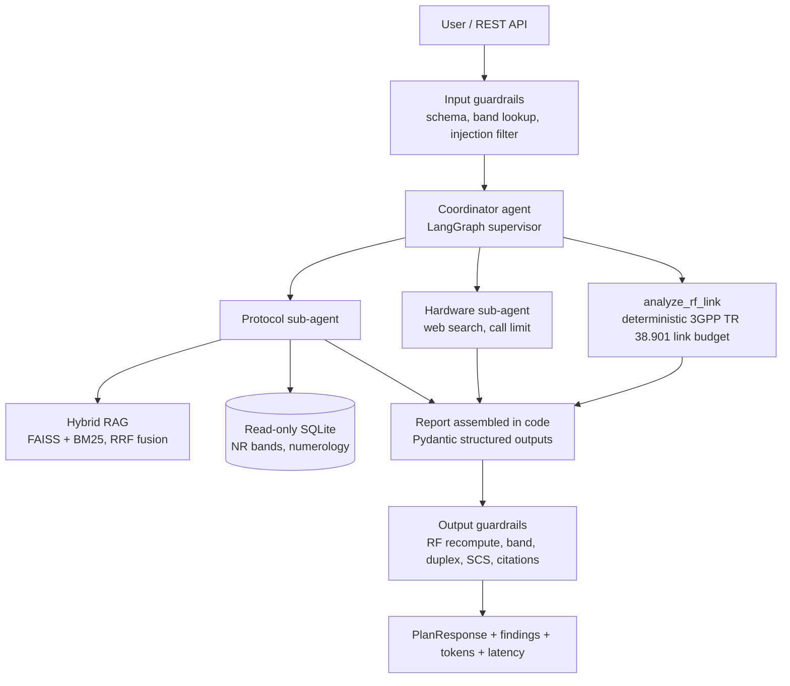
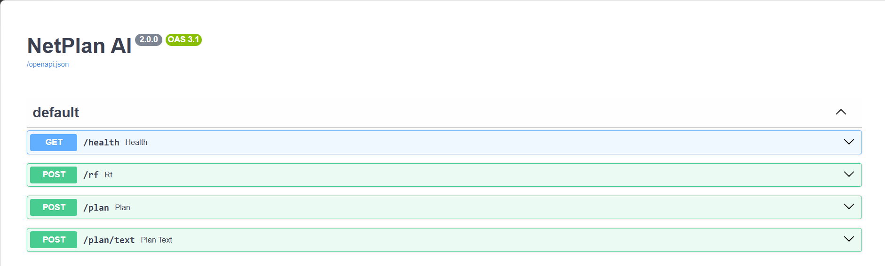
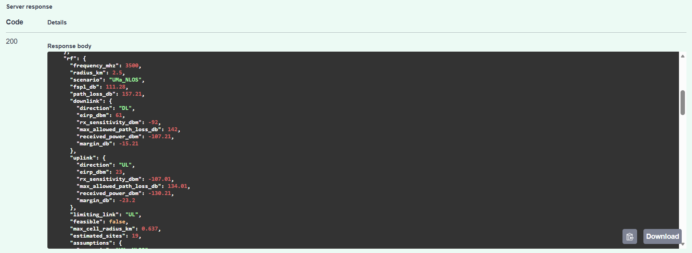

# NetPlan AI

Multi-agent LLM system that plans 4G/5G network deployments. Give it a region, frequency and coverage radius and it returns a structured technical report with a 3GPP link budget, protocol parameters cited from the specifications, a sourced hardware shortlist, risks and next steps.

The design goal is **reliability over fluency**. Numbers come from deterministic code, protocol claims must cite the 3GPP text, and every report passes output guardrails before it reaches the user.

## Architecture



| Component | What it does |
|---|---|
| `netplan/rf.py` | FSPL and 3GPP TR 38.901 UMa/UMi path loss (LOS/NLOS, breakpoint distance), DL and UL link budget, max cell radius by bisection, site count estimate |
| `netplan/rag.py` | PDF ingestion with page metadata, chunking with overlap, persisted FAISS index with change detection, hybrid dense + BM25 retrieval fused with Reciprocal Rank Fusion |
| `netplan/agents.py` | Coordinator plus two sub-agents built with `create_agent`. Structured outputs, retries, model and tool call limits, optional model fallback, token usage tracking |
| `netplan/guardrails.py` | Prompt injection filter, frequency to band validation, deterministic correction of RF values, band, duplex and subcarrier spacing checks, grounding checks |
| `netplan/telecom_db.py` | Reference DB of NR bands and numerology with a read-only connection and SELECT-only guard |
| `netplan/api.py` | FastAPI service with `/plan`, `/plan/text`, `/rf` and `/health` |
| `evals/` | Offline evaluation with regression gate and optional LLM-as-a-judge |
| `tests/` | 28 tests, including the full multi-agent graph with a scripted model, so CI runs without API keys |

## Why v2: what the first version got wrong

The first notebook used free space path loss and let the LLM assume the rest of the link budget. For a 5G private network at 3500 MHz with 2.5 km radius it concluded the link was viable with about 14 dB of margin.

The v2 engine uses the 3GPP UMa NLOS model and checks both directions. The uplink (23 dBm UE) is the limiting link, the maximum cell radius is about 0.64 km and the area needs around 19 sites. Same question, opposite engineering decision. That gap is why RF numbers are never generated by the LLM in this project.

```bash
python -m netplan.cli rf 3500 2.5
# path_loss_db 157.2 (FSPL alone: 111.3), limiting_link UL, feasible false,
# max_cell_radius_km 0.637, estimated_sites 19
```

A second lesson came from free text parsing. A small model extracting the request also filled the optional link budget fields with zeros (0 dBm, 0 dBi, FSPL). The fix was to narrow the extraction schema to what the user actually says and apply engineering defaults in code, plus a sanity guardrail on the link budget.

The v1 report also suggested 15 kHz subcarrier spacing for n78. It is legal but unusual. v2 flags it as a guardrail warning and suggests 30 kHz.

## Screenshots




## Quick start

```bash
python -m venv .venv && source .venv/bin/activate
pip install -e ".[dev]"
cp .env.example .env          # add OPENAI_API_KEY and TAVILY_API_KEY

python -m netplan.cli init-db
# put 3GPP PDFs in data/specs (see data/specs/README.md)
python -m netplan.cli ingest

uvicorn netplan.api:app --reload
```

```bash
curl -X POST localhost:8000/plan -H "Content-Type: application/json" -d '{
  "region": "Interior de São Paulo, área industrial",
  "network_type": "5G Private",
  "frequency_mhz": 3500,
  "coverage_radius_km": 2.5,
  "use_case": "AGVs e sensores"
}'
```

Or with Docker:

```bash
docker build -t netplan-ai .
docker run --env-file .env -p 8000:8000 -v $PWD/data:/app/data netplan-ai
```

### AWS Bedrock

Models are resolved with `init_chat_model`, so switching providers is configuration only:

```bash
pip install -e ".[aws]"
NETPLAN_COORDINATOR_MODEL=bedrock_converse:us.anthropic.claude-sonnet-4-5-20250929-v1:0
NETPLAN_EMBEDDINGS_PROVIDER=bedrock
NETPLAN_EMBEDDINGS_MODEL=amazon.titan-embed-text-v2:0
```

## Evaluation

```bash
python -m evals.run_evals --save-baseline   # first run
python -m evals.run_evals --judge           # later runs, fails on regression
```

8 scenarios across FR1 and FR2 (700 MHz rural, 2.3 GHz small cell, 3.5 GHz private, 26 GHz stadium and others). Metrics per run:

| Metric | Meaning |
|---|---|
| `band_correct`, `duplex_correct` | Protocol agent picked a band and duplex mode consistent with the frequency |
| `scs_valid` | Subcarrier spacing allowed for that band |
| `citation_coverage` | Share of protocol parameters grounded in a retrieved 3GPP passage |
| `hardware_sourced` | Share of hardware options with a source URL |
| `groundedness` | LLM-as-a-judge score of summary, risks and next steps against tool data |
| `retrieval_hit@k` | Retrieval quality on a fixed set of 3GPP queries |
| `latency_p50_s`, `avg_tokens` | Performance and cost |

A metric that drops more than the tolerance below the baseline returns exit code 1. In CI the eval job runs on pull requests labeled `run-evals`, so prompt or model changes are checked before merge.

## Observability

Set `LANGSMITH_TRACING=true` to trace every run in LangSmith (agent steps, tool calls, latency, tokens). The API also returns token usage per model and end to end latency in every response.

## Tests and CI

```bash
pytest -q && ruff check .
```

GitHub Actions runs lint, tests and a Docker build on every push. The multi-agent test replaces the LLM with a scripted chat model, so the whole LangGraph flow, tool calls and structured outputs are exercised without API keys.

## Limitations

- Path loss uses 3GPP UMa/UMi formulas without LOS probability or shadow fading draws. Rural macro (RMa) and indoor factory (InF) models are not implemented yet.
- Single-cell link budget. No interference simulation or capacity dimensioning.
- The band table is reference data. Confirm against the current 3GPP release and Anatel rules before a real deployment.
